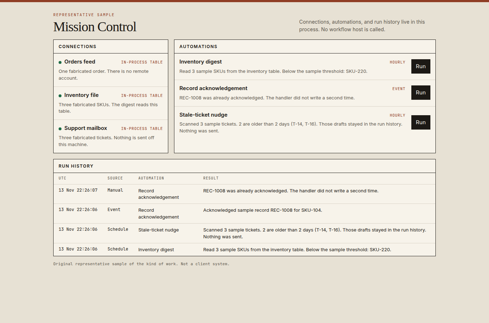
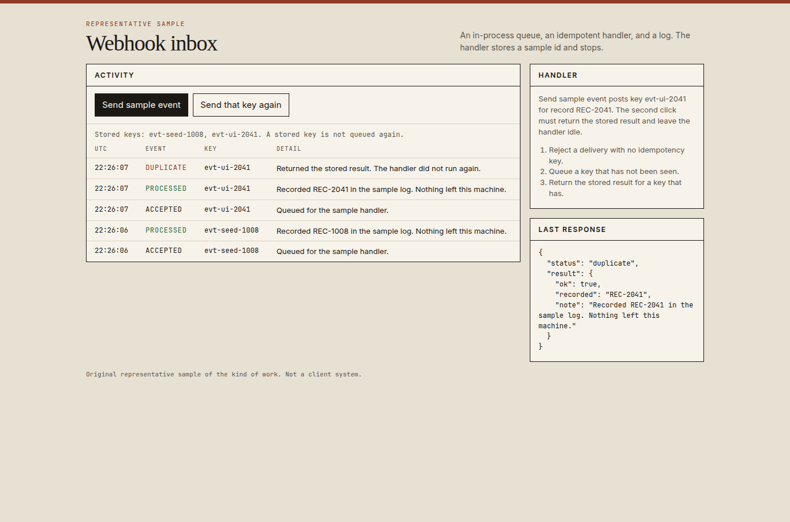
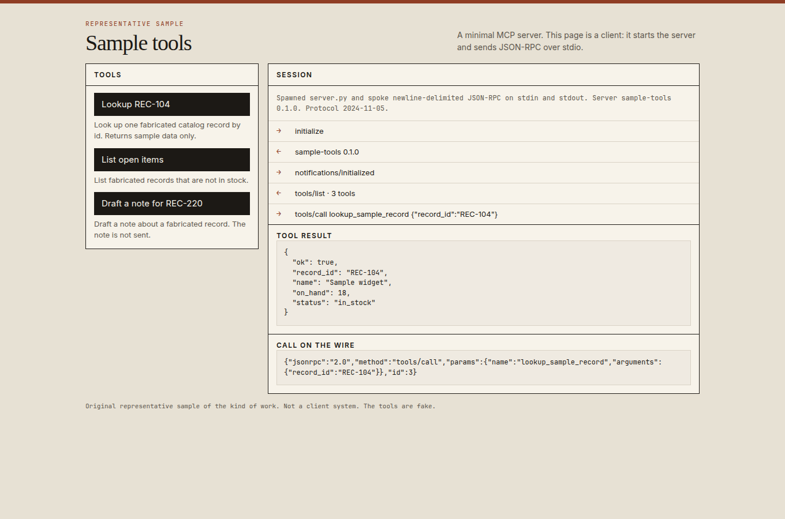
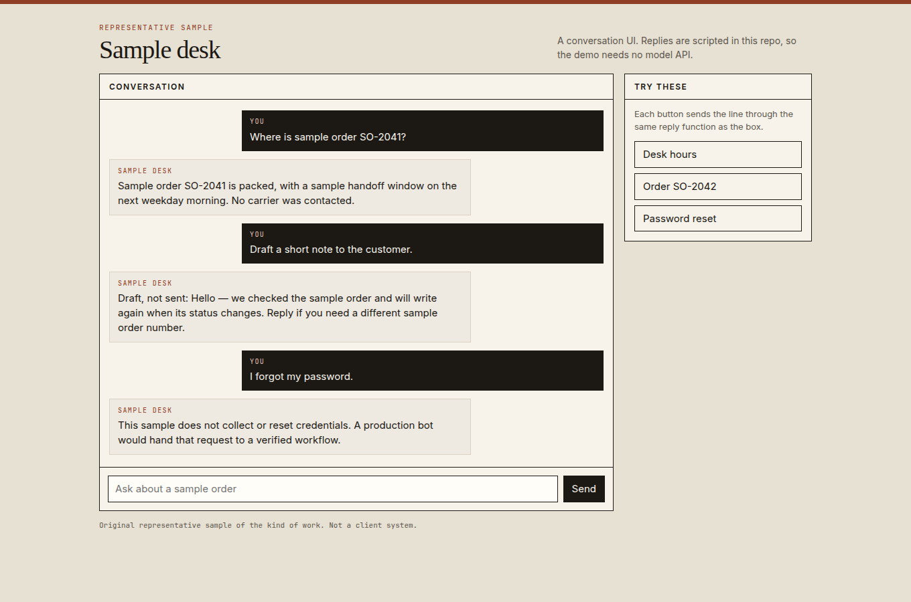
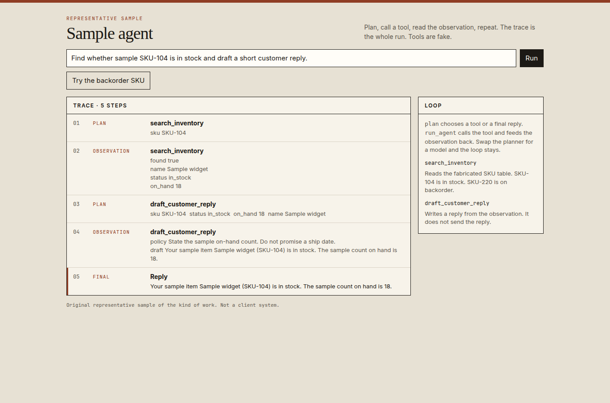

# Demo projects

Representative samples for people deciding whether to hire Joe Edler / [SMB Automators](https://github.com/SmbAutomators).

These programs are original. They use a fabricated catalog, and they are not a client's production system, data, or implementation. Each one runs on a laptop with Python 3.10 or newer. No API key, account, or hosted workflow product is required.

The same made-up records show up in more than one folder: sample SKUs, sample orders, sample tickets. That is so the five programs are easy to compare. The folders do not import each other, and none of the records are real.

## Samples

| Folder | What it shows | Run |
| --- | --- | --- |
| [mission-control](mission-control/) | An interface that holds its own connections and runs its own automations | `python3 mission-control/app.py` then open http://127.0.0.1:8741 |
| [backend-automation](backend-automation/) | A webhook, an in-process queue, and an idempotent handler with a log | `python3 backend-automation/app.py` then open http://127.0.0.1:8742 |
| [mcps](mcps/) | A minimal MCP server and a page that talks to it over stdio | `python3 mcps/console.py` then open http://127.0.0.1:8743 |
| [chat-bots](chat-bots/) | A conversation UI backed by a scripted desk, not a model API | `python3 chat-bots/app.py` then open http://127.0.0.1:8744 |
| [agents](agents/) | An agent loop with two fake tools and the trace on screen | `python3 agents/app.py` then open http://127.0.0.1:8745 |

Stop a sample with Ctrl+C. Each process binds to `127.0.0.1` only. Each folder's README explains the code to read.

## Mission Control

The dashboard lists sample connections, the automations registered in the process, and the runs those automations have already produced. The runner is in this process.

## Backend automation

Sending the same idempotency key twice records one handled event and one duplicate. The second delivery does not run the handler again.

## MCP server

The console starts `server.py`, lists its tools, and calls one. The tools return fabricated records. A host such as Cursor wires the same stdio server; the note is in [mcps/README.md](mcps/README.md).

## Chat bot

The thread is a sample desk. Replies come from rules in the repo, including a refusal to touch credentials.

## Agent

The loop looks up sample SKU-104 and drafts a reply. The planner is scripted so the trace runs with no model API. `plan` is the function to replace with a model call.

## What is not in this repository

Client names, production credentials, private data, and proprietary implementations. These folders stand in for the shape of the work.
