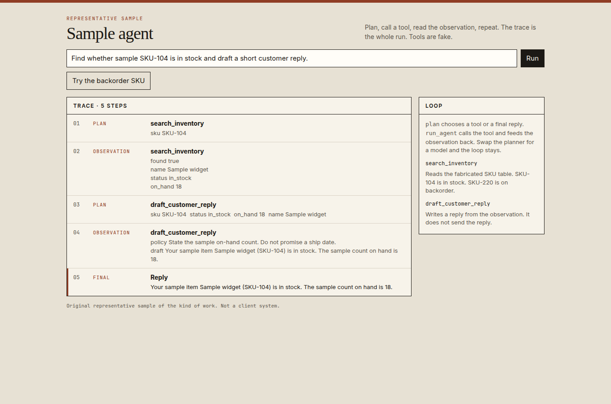

# Sample agent

Original representative sample of an agent loop. Not a client system.

`run_agent` asks `plan` what to do, calls a tool, records the observation, and repeats until the planner returns a final reply. The trace on the page is that loop, one row per step.

The tools are fake. `search_inventory` reads a three-line table. `draft_customer_reply` writes a sentence from the observation and does not send it. `plan` is scripted so the demo runs with no model API. It returns the same shape a model would: either a tool call or a final reply. Replace `plan` and leave the loop.

## What it shows

- A loop with a step limit
- Two tools and the arguments passed to them
- Observations fed back into the next plan
- A visible trace, including the final reply

## Run

From this folder:

```bash
python3 app.py
```

Open http://127.0.0.1:8745

Python 3.10 or newer. The standard library is enough.

The page opens on a finished run for sample `SKU-104`, which is in stock. Press **Try the backorder SKU** for `SKU-220`. A goal with no SKU stops before any tool call. An unknown SKU is looked up, then the loop stops without a draft.



## Where to read

- `plan` — the stand-in planner
- `run_agent` — the loop
- `search_inventory` and `draft_customer_reply` — the tools

The inventory in this file is fabricated. It is not a stock system.
