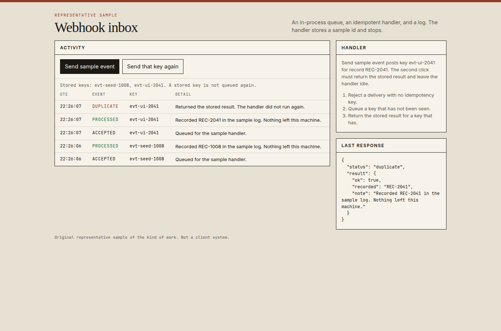

# Webhook inbox

Original representative sample of a backend automation. Not a client system.

`POST /api/events` takes a JSON event with an idempotency key. A new key is put on an in-process queue. A worker thread runs `apply` once and stores the result. The same key again returns that result and does not enter the queue.

`apply` records a fabricated record id in memory. It has no client business rules and it does not call another service.

## What it shows

- A webhook entry point
- A queue and a worker
- An idempotent handler
- A log of accepted, processed, and duplicate deliveries

## Run

From this folder:

```bash
python3 app.py
```

Open http://127.0.0.1:8742

Python 3.10 or newer. The standard library is enough.

The page starts with one seeded delivery, `evt-seed-1008`, already processed through the queue. **Send sample event** posts key `evt-ui-2041`. **Send that key again** must come back as a duplicate. You can post your own event:

```bash
curl -s -X POST http://127.0.0.1:8742/api/events \
  -H 'Content-Type: application/json' \
  -d '{"idempotency_key":"evt-1","type":"sample.record.created","payload":{"record_id":"REC-315"}}'
```

A body with no `idempotency_key` is rejected. A second post of `evt-1` returns the stored result.



## Where to read

- `accept` — the idempotency check and the queue
- `worker` — the consumer
- `apply` — the only handler, and the whole of the sample's "business" step

The request waits until the worker finishes so the page can show the log line. The work still crosses the queue.
