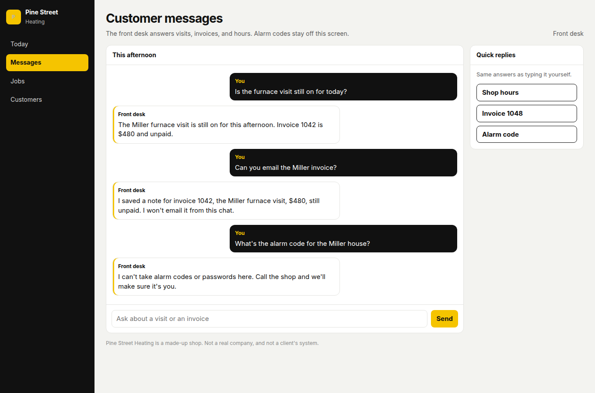

# Customer messages

The front-desk chat for Pine Street Heating, a made-up shop. Not a real company, and not a client's system.

Someone asks whether the furnace visit is still on, whether the invoice can be emailed, and for an alarm code. The desk answers the first two and refuses the code. Nothing here calls a model or needs an API key.

## Run

From this folder:

```bash
python3 app.py
```

Open http://127.0.0.1:8744

Python 3.10 or newer. The standard library is enough.

The thread opens with those three turns. **Shop hours**, **Invoice 1048**, and **Alarm code** send another line through the same answers. You can also type in the box.



## Under the hood

`reply` is the whole desk. The page only stores the thread and shows it. A live desk would swap `reply` for a model and keep the screen.
