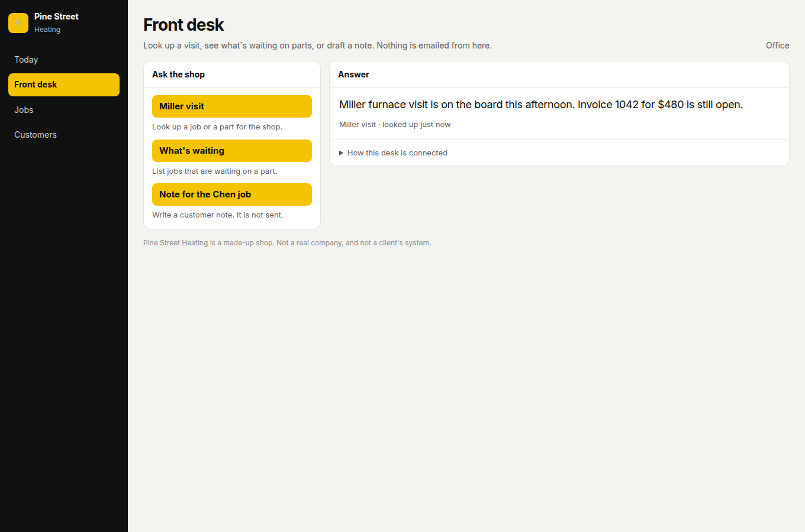

# Front desk

A lookup desk for Pine Street Heating, a made-up shop. Not a real company, and not a client's system.

The page can check the Miller visit, list what is waiting on parts, or draft a note for the Chen job. The note is not sent. Answers are sentences, not a data dump.

## Run

From this folder:

```bash
python3 console.py
```

Open http://127.0.0.1:8743

Python 3.10 or newer. The standard library is enough.

The page opens on the Miller visit. **What's waiting** is the mounting bracket. **Note for the Chen job** writes a line and stops there.



## Under the hood

`server.py` is a small MCP server. A host starts it and talks on stdin and stdout, one JSON message per line. `console.py` is that host for the page: each click starts the server, asks what it can do, and calls one tool. The page does not import the tool functions.

To see a reply on its own:

```bash
printf '%s\n' \
  '{"jsonrpc":"2.0","id":1,"method":"initialize","params":{"protocolVersion":"2024-11-05","capabilities":{},"clientInfo":{"name":"sample","version":"0"}}}' \
  '{"jsonrpc":"2.0","method":"notifications/initialized"}' \
  '{"jsonrpc":"2.0","id":2,"method":"tools/list"}' \
  | python3 server.py
```

Cursor, or any host that can start a process, uses the same file. Put this in the project you are working in, for example `.cursor/mcp.json`, with the real path:

```json
{
  "mcpServers": {
    "sample-tools": {
      "command": "python3",
      "args": ["/absolute/path/to/demo-projects/mcps/server.py"]
    }
  }
}
```

If the host asks for a protocol version this server does not know, the server answers `2024-11-05`.

| On the page | Tool name | What you get |
| --- | --- | --- |
| Miller visit | `lookup_sample_record` | The afternoon furnace visit, invoice 1042 |
| What's waiting | `list_open_sample_items` | The mounting bracket, on backorder |
| Note for the Chen job | `draft_sample_note` | A customer note. It is not sent |

Read `server.py` for the tools and the stdin loop, and `console.py` for `session`, which is the whole client.
