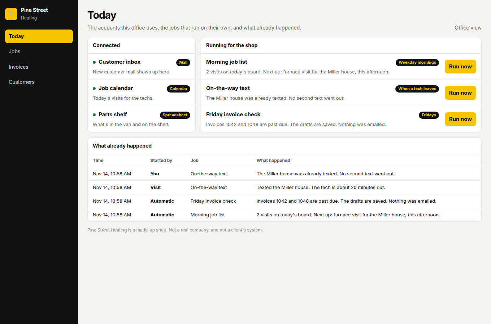

# Today

The office view for Pine Street Heating, a made-up shop. Not a real company, and not a client's system.

Mail, the job calendar, and the parts shelf show as connected. Three jobs run for the shop: the morning job list, an on-the-way text when a tech leaves, and a Friday check of unpaid invoices. The bottom of the page is what already happened.

## Run

From this folder:

```bash
python3 app.py
```

Open http://127.0.0.1:8741

Python 3.10 or newer. The standard library is enough. Ctrl+C stops it.

On open, the morning list and the Friday invoice check have already run, and the Miller house has been texted. Press **Run now** on the on-the-way text. The new line says the house was already texted, and no second text went out.



## Under the hood

The jobs live in this process. Scheduled runs and the Run now button use the same path. Nothing is handed to Zapier, n8n, or Make.

Read `AUTOMATIONS` for the three jobs, `execute` for a single run, and `tick` for the clock.
